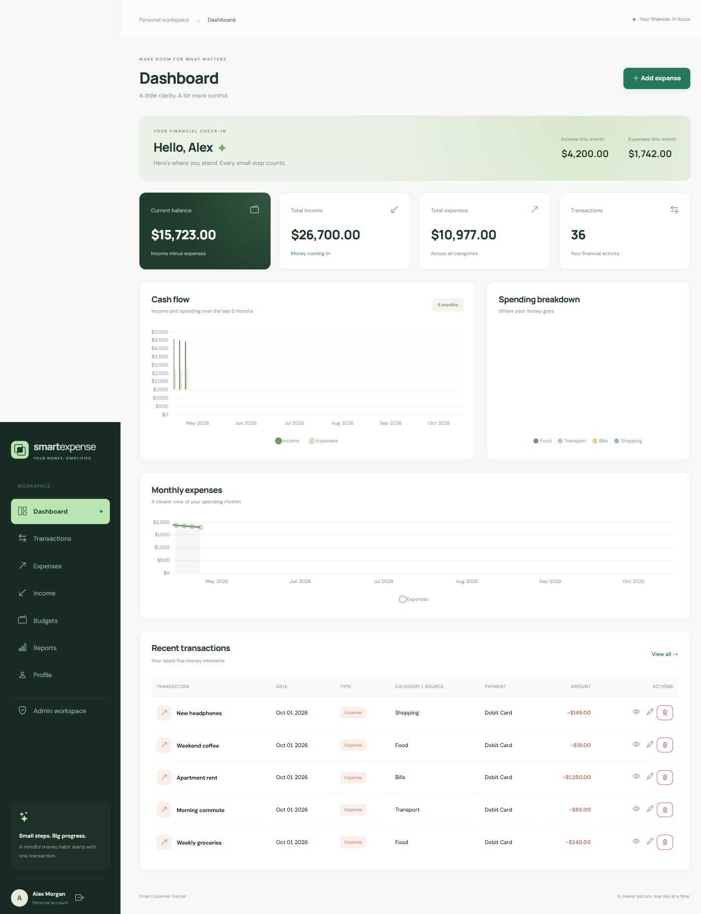
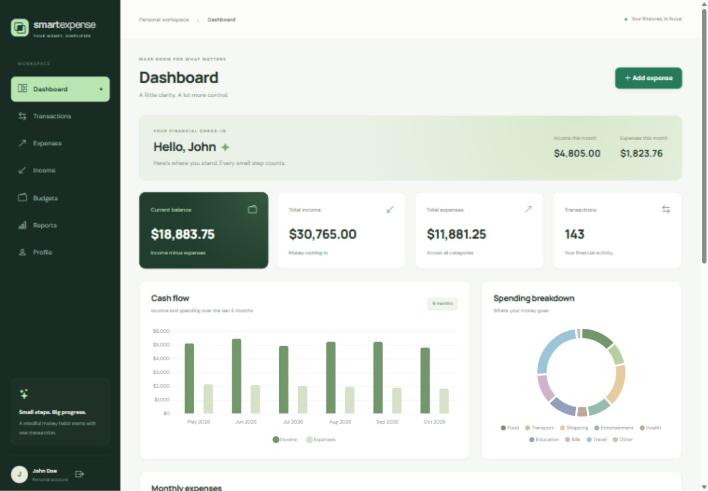

# Smart Expense Tracker

A thoughtful personal finance workspace built with Flask. Track income and expenses, plan category budgets, and understand financial habits through interactive charts. A separate protected admin workspace provides user management and platform analytics.

## Features

- Registration, login, POST logout, profile editing, and password changes
- Secure password hashing, CSRF protection, validated forms, and per-user ownership checks
- Expense and income creation, detail views, editing, and confirmed deletion
- Combined histories with title/description/category search, date ranges, category/source, type, payment method, and amount filters
- Ten-record pagination that retains active filters
- Monthly category budgets with warning and exceeded states, editing, and deletion
- Dashboard totals, current-month totals, recent transactions, and Chart.js analytics
- Monthly, previous-month, yearly, and custom-range financial reports
- Admin dashboard, user search/details, account activation, administrator permissions, platform transactions, and registration analytics
- Responsive sidebar, mobile layouts, empty states, flash alerts, and custom error pages

## Screenshots

| View | Screenshot |
| --- | --- |
| Dashboard | [Dashboard screenshot](docs/screenshots/dashboard.jpg) |
| Admin dashboard | [Admin dashboard screenshot](docs/screenshots/admin-dashboard.jpg) |
| Expense management | [Expense management screenshot](docs/screenshots/expenses.jpg) |



Screenshots use disposable sample data. For a populated local preview, run `python tests/preview_server.py`, open `http://127.0.0.1:5001`, and sign in using the temporary credentials printed in the terminal. The preview uses an in-memory database and resets when stopped.

## Technology stack

Python, Flask, Flask-SQLAlchemy, Flask-Login, Flask-WTF, WTForms, Werkzeug, SQLite, HTML5, CSS3, Bootstrap 5, Bootstrap Icons, JavaScript, and Chart.js. Waitress serves the application when launched with `python app.py`.

## Installation

Use Python 3.8 or later (a currently supported Python release is recommended).

```bash
git clone <your-repository-url>
cd smart-expense-tracker
python -m venv .venv
```

Activate the environment on Windows PowerShell:

```powershell
.\.venv\Scripts\Activate.ps1
```

Or on macOS/Linux:

```bash
source .venv/bin/activate
```

Install and launch:

```bash
pip install -r requirements.txt
python app.py
```

Open [http://127.0.0.1:5000](http://127.0.0.1:5000). The SQLite database and tables are automatically created under `instance/` on first run. Register your own account to begin; new accounts start with no transactions.

For a persistent session secret, copy `.env.example` to `.env` and replace `SECRET_KEY` with the output of `python -c "import secrets; print(secrets.token_hex(32))"`. `.env` and databases are excluded from version control. Without an explicit secret, development uses a new random key at each launch, invalidating earlier sessions.

Frontend libraries and fonts load from CDNs and require internet access. Financial values use USD and two decimal places. Transaction dates are calendar dates; creation timestamps are stored in UTC. Monthly reporting boundaries use the server's calendar date.

## Admin login

Run the interactive account creation script:

```bash
python create_admin.py
```

Enter a full name, unique username, valid email, and a password of at least 10 characters. Password input is hidden and must be confirmed. This admin creation script has no hard-coded credentials. Existing accounts are never silently promoted by the script. Sign in normally, then select **Admin workspace** or visit `/admin/`.

Administrators can view platform-wide financial data. Members can access only their own records. The current admin cannot deactivate, demote, or delete their own account. Deactivating an account prevents login and invalidates its authenticated sessions on subsequent requests. Deleting a user also removes their transactions and budgets.

### Demo Data

Populate the configured local database with realistic portfolio demo data:

```bash
python seed_data.py
python app.py
```

The seed creates one admin, two demo members, **360 expenses**, **69 income records**, and **54 monthly category budgets**. All three accounts have populated dashboards. Transactions cover the current month and five previous months using dates relative to the day you run the script, with no future transaction dates. Budgets cover the current month and two previous months, demonstrating low usage, approximately 75%, nearly 100%, and exceeded limits. Registration dates are spread across months for admin analytics.

| Account | Username | Email | Password |
| --- | --- | --- | --- |
| Admin User | admin | admin@example.com | Admin123! |
| John Doe | johndoe | john@example.com | User123! |
| Sarah Khan | sarah | sarah@example.com | User123! |

**These intentionally public credentials are for local/development/demo use only. Production deployments must remove these accounts or change their credentials.** Seeding refuses to run when `APP_ENV=production`. Passwords use the same secure `User.set_password()` hashing method as the application and are never stored as plaintext in the database. The requested short demo passwords are seed-only; normal registration still requires at least 10 characters.



Repeated runs print `Demo data already exists. Skipping seed process.` To regenerate dates and sample financial records:

```bash
python seed_data.py --reset
```

A database ownership manifest identifies seed-created accounts and records. Reset retains the original demo accounts, replaces only unchanged seed-owned expenses/income/budgets, and preserves other users and manually added records, including records added to demo accounts. If a seeded row or account was edited/replaced, reset refuses to delete it. Username/email collisions with pre-existing accounts are never overwritten or promoted. Any reset failure rolls back the entire operation. For a clean seed when existing accounts collide, use a separate local demo database by setting `DATABASE_URL` in `.env`.

## Project structure

```text
app.py                  Application factory, startup, and error handlers
config.py               Environment configuration
create_admin.py         Interactive administrator creation
seed_data.py            Repeatable demo seed and ownership-checked reset
tracker/
  extensions.py         Database, login manager, and CSRF
  models.py             User, Expense, Income, and Budget relationships
  forms.py              Server-side form validation
  routes.py             Authentication, main, expense, income, budget, admin blueprints
  services.py           Transaction querying, pagination, and financial calculations
templates/
  base.html             Shared responsive shell
  macros.html           Reusable forms, tables, charts, and cards
  admin/                Separate admin views
static/css/             Design system and admin styles
static/js/              Navigation, confirmations, pagination, charts
tests/                  Integration and access-control tests
instance/               Local SQLite database (ignored)
```

## Verification

```bash
python -m unittest discover -s tests -v
```

Tests use isolated in-memory databases. They cover registration, login/logout, profile/password updates, CSRF, CRUD, filters, pagination, budgets, validation, ownership, admin authorization, self-protection, and inactive accounts.

Seed tests also verify exact record counts, hashed demo credentials, six months of chart data, budget progress states, first-of-month/year boundaries, repeated-run idempotency, safe resets, identity collisions, and foreign-key integrity.

## Deployment

Set `APP_ENV=production`, a strong persistent `SECRET_KEY`, and `COOKIE_SECURE=true` when serving over HTTPS. The launcher binds to localhost; configure a reverse proxy with HTTPS for public hosting, and use `PORT` to change the local port. SQLite suits local use and small installations. Back up the database before updates. `create_all()` initializes tables; schema changes on existing databases require a migration workflow.

Before publishing your portfolio, replace the landing page's example contact address and generic GitHub topic link with your real links. Public hosting should additionally add login rate limiting, account recovery, monitoring, database migrations, and operational backups.

## Future improvements

- CSV/PDF exports and recurring transactions
- Multiple currencies and user timezone preferences
- Email verification, password recovery, and login rate limits
- Notifications and financial insights
- Database migrations and PostgreSQL deployment

## License

MIT. See [LICENSE](LICENSE).
